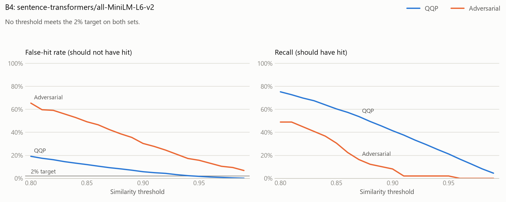

# Benchmarks

Results of the v1 benchmarks in [SPEC.md §9](SPEC.md): **B1** (gateway overhead), **B1b**
(streaming time to first chunk) and **B2** (throughput ceiling, 1 and 3 replicas). Every
number below was produced by `bash bench/run_all.sh` and computed from k6's raw output by
[bench/report.py](bench/report.py) (the results) and [bench/compare.py](bench/compare.py)
(the before/after table). The raw output is committed:

- [bench/results/20261104T102940Z/](bench/results/20261104T102940Z/): the current results,
  with the healthcheck fix.
- [bench/results/20261103T190904Z/](bench/results/20261103T190904Z/): the baseline before
  it, kept for the [before/after comparison](#the-healthcheck-fix-before-and-after).

Each benchmark ran 3 times; tables give the **median** of the 3 runs and, in brackets, the
**range** (lowest to highest run), so one noisy run can't skew a result.

**B3** (failover), **B4** (the semantic cache's accuracy) and **B5** (the cache's impact)
have run too, each in its own section with its own method and environment:
[B3](#b3-failover), [B4](#b4-semantic-cache-evaluation), [B5](#b5-cache-impact). B6 hasn't
been run.

## Summary

| Benchmark | SPEC target | Result (median, range) | Met? |
|---|---|---|---|
| B1 overhead p50, non-streamed | < 5 ms at 500 RPS | 2.61 ms (2.58 to 2.61) at **100 RPS** | at 100 RPS only (see the deviation below) |
| B1 overhead p99, non-streamed | < 20 ms at 500 RPS | 13.03 ms (12.45 to 13.61) at 100 RPS | at 100 RPS only |
| B1b time-to-first-chunk overhead p99 | < 20 ms, same load as B1 | 10.56 ms (9.98 to 11.19) at 100 RPS | at 100 RPS only |
| B2 max sustained RPS, 1 replica | report it | 250 (225 to 250) | – |
| B2 max sustained RPS, 3 replicas | report it | 275 (250 to 325) | – |
| B4 false hits, an embedding model alone | ≤ 2% on QQP and on the adversarial set | no threshold from 0.80 to 0.99 meets it, for any of the 4 models (single run) | no |
| B4 false hits, all-MiniLM-L6-v2 then an NLI cross-encoder, at 0.90 | ≤ 2% on both sets | QQP 1.64% (41/2,500), adversarial 1.57% (3/191) | yes |
| B4 recall at that threshold | report it | QQP 24.4% (610/2,500), hard positives 42.9% (21/49) | – |
| B4 miss path p99: embedding, then the lookup | < 25 ms | embedding alone 18.5 ms; the lookup is B5's to time | embedding share only |
| B3 failed requests, from the kill to steady state (or the run's end) | < 1% at 300 RPS | 300 RPS: 37.11 to 95.65% (3 runs); 200 RPS: 1.33 to 2.87%; steady state never reached | no |
| B3 control: the same kill, providers reached by IP address | – | 300 RPS: no request failed, in the whole run (0/34,496 and 0/35,159) or the failover window (0/2,695 and 0/2,015); steady in 14 and 9 s | – |
| B5 hit rate, semantic layer off / on (B5's workload) | report it | 61.6% (12,315/20,000) / 64.2% (12,838 and 12,831 of 20,000), 2 runs | – |
| B5 cost saved, layer off / on | report it | 61.5% / 64.1% | – |
| B5 latency p50 on hits, exact / semantic | report it | 2.8 to 3.0 ms / 177.9 and 191.8 ms (misses: 1,006 to 1,039 ms) | – |
| B5 miss path p99: embedding, its wait, then the lookup | < 25 ms | 91.4 and 103.0 ms | no |
| B5 hit path p99: the miss path, then the check | report it | 1,001.8 and 923.2 ms | – |
| B5 rejected candidates, and their check's p50 / p99 | report it | 26.1% (2,009/7,702) and 26.0% (2,002/7,702); 140 to 145 / 872 to 876 ms | – |
| B5 overhead p99 for non-cacheable requests, layer off / on, during the replay | report it | 11.06 and 11.30 ms / 19.26 and 35.23 ms | – |

**Deviation from SPEC:** B1 and B1b ran at 100 RPS, not 500. One gateway replica limited
to one CPU cannot sustain 500 RPS on this machine (its B2 ceiling is 250 RPS), so at 500
RPS B1 would measure queueing rather than overhead. The rate stayed at 100 RPS after the
healthcheck fix so the before/after compares like with like. B2 reports the real ceilings.

## Environment

| | |
|---|---|
| Machine | Laptop: Intel Core i7-1165G7 (4 cores, 8 threads, 2.8 GHz base), 15.7 GB RAM |
| OS | Windows 11 Home, build 26300; power plan: Balanced |
| Docker | Docker Desktop 29.6.1 on WSL2 (kernel 6.18.33.2-microsoft-standard-WSL2); VM: 8 CPUs, 7.6 GiB (WSL defaults, no `.wslconfig`) |
| Code | commit `42544e4` plus the uncommitted changes listed in [environment.txt](bench/results/20261104T102940Z/environment.txt): the healthcheck change in `docker-compose.yml`, and the harness changes in `bench/` (status codes, throttling counters). The gateway's code is the same as in the baseline. |
| Load generator | k6 v1.0.0 (`grafana/k6:1.0.0`), in a container on the same Docker network as the stack |
| Run | 2026-11-04, 10:29 to 11:47 UTC (baseline: 2026-11-03, 19:09 to 20:10 UTC) |

Fixed resource limits ([bench/docker-compose.bench.yml](bench/docker-compose.bench.yml)),
checked on the running containers by `docker inspect`, with the CFS quota each limit
became (the container's `/sys/fs/cgroup/cpu.max`: µs of CPU per period, then the period
in µs), all recorded in the results:

| Service | CPUs | CFS quota (`cpu.max`) | Memory | Settings |
|---|---|---|---|---|
| gateway (each replica) | 1.0 | 100000 per 100000 | 512 MiB | 1 uvicorn worker (`WEB_CONCURRENCY=1`), `LOG_LEVEL=WARNING`, mock-only providers config; healthcheck in bash builtins |
| mock_provider | 1.5 | 150000 per 100000 | 512 MiB | 1 worker, access log off, log level warning; no latency, no TTFT delay, unpaced streams, 32 output tokens; healthcheck in bash builtins |
| postgres | 1.0 | 100000 per 100000 | 1 GiB | `max_wal_size=512MB`; the ledger table is emptied before every step |
| redis | 0.5 | 50000 per 100000 | 256 MiB | defaults |
| nginx (B2 only) | 0.5 | 50000 per 100000 | 128 MiB | [nginx/nginx.conf](nginx/nginx.conf) |
| k6 | 1.5 | not recorded | 1.5 GiB | |

With 3 replicas the limits add up to the VM's 8 CPUs, and those are 8 hyperthreads on 4
physical cores: the 3-replica figures are for a fully committed laptop.

## Method

Each **step** is one k6 run ([bench/k6/chat.js](bench/k6/chat.js)) with two phases: the load
sent straight to the mock, then the same load through the gateway. Each phase is a warm-up
followed by a measured period; only the measured period is reported. Load is open-model
(k6 `constant-arrival-rate`: 50 pre-allocated VUs, up to 400), so a slow server can't slow
the arrival rate down. Requests are `POST /v1/chat/completions` for `gpt-4o-mini` with a
short prompt and `max_tokens: 32`, from a benchmark tenant with limits no test reaches.

- **Overhead** is the gateway's latency minus the mock's at the same percentile: a
  difference of percentiles, not a percentile of per-request differences.
- **B1** times non-streamed requests by `http_req_duration`. **B1b** times streamed ones by
  `http_req_waiting` (time to first byte): the gateway sends its response headers with the
  first SSE chunk, and the mock right before its first chunk, so this is time to first
  chunk. 100 RPS, 10 s warm-up, 60 s measured, one replica reached directly.
- **B2** goes through nginx. Steps start at 50 RPS and rise by 25 (5 s warm-up and 20 s
  measured per phase) until a step fails: p99 overhead above 50 ms, more than 0.1% of
  requests failed, or k6 unable to start requests on time. The last step that held is the
  ceiling. The mock is measured at each step's rate as that step's baseline.
- **Failures are explained, not only counted.** Every response other than a 200, and every
  stream that ends without `data: [DONE]`, is written to the step's log with its status,
  k6's error code, its duration and the start of its body. Responses are also counted by
  status (0 means no response at all: refused, reset or timed out). The "other than a
  complete 200" columns come from those counts.
- **CPU and throttling** come from the cgroup counters (`cpu.stat`) of the gateways, the
  mock and nginx, read before and after every step:
  - CPU used.
  - CFS periods: how many there were, in how many the container was throttled, and for
    how long.

  "17 of 362 (avg 43 ms each)" means the container was stopped for lack of quota in 17 of
  the step's 362 100-ms periods, for 43 ms on average each time. **Gateway CPU per
  request** is the gateways' CPU across the step divided by the requests they served in
  it, warm-up included. It includes fixed costs (the benchmark's setup calls, the
  healthcheck), so it reads higher at low rates.

## Results

#### B1: gateway overhead, non-streamed

`http_req_duration`, ms: median of 3 runs (range across runs).

| | p50 | p95 | p99 |
|---|---|---|---|
| Mock, direct | 1.21 (1.18 to 1.22) | 1.99 (1.99 to 2.00) | 2.18 (2.17 to 2.25) |
| Through the gateway | 3.80 (3.79 to 3.83) | 8.08 (8.04 to 8.15) | 15.28 (14.62 to 15.80) |
| **Overhead** | 2.61 (2.58 to 2.61) | 6.07 (6.05 to 6.15) | 13.03 (12.45 to 13.61) |

| Run | Requests (gateway) | Failed | Not started on time | Responses other than a complete 200 | Gateway CPU per request | Gateway throttled periods | Mock throttled periods |
|---|---|---|---|---|---|---|---|
| 1 | 6001 | 0.00% | 0 | none | 3.40 ms | 0 of 945 | 0 of 1420 |
| 2 | 6001 | 0.00% | 0 | none | 3.39 ms | 0 of 951 | 0 of 1422 |
| 3 | 6001 | 0.00% | 0 | none | 3.37 ms | 0 of 947 | 0 of 1420 |

#### B1b: time to first chunk, streamed

`http_req_waiting`, ms: median of 3 runs (range across runs).

| | p50 | p95 | p99 |
|---|---|---|---|
| Mock, direct | 1.18 (1.11 to 1.20) | 1.84 (1.83 to 1.87) | 2.00 (1.97 to 2.02) |
| Through the gateway | 2.30 (2.30 to 2.32) | 6.12 (5.98 to 6.21) | 12.58 (11.95 to 13.19) |
| **Overhead** | 1.13 (1.10 to 1.21) | 4.25 (4.14 to 4.38) | 10.56 (9.98 to 11.19) |

| Run | Requests (gateway) | Failed | Not started on time | Responses other than a complete 200 | Gateway CPU per request | Gateway throttled periods | Mock throttled periods |
|---|---|---|---|---|---|---|---|
| 1 | 6000 | 0.00% | 0 | none | 4.76 ms | 0 of 921 | 0 of 1425 |
| 2 | 6000 | 0.00% | 0 | none | 4.78 ms | 0 of 925 | 0 of 1423 |
| 3 | 6000 | 0.00% | 0 | none | 4.73 ms | 0 of 928 | 0 of 1422 |

#### B2: throughput ceiling (through nginx)

Highest RPS step that held (p99 overhead ≤ 50 ms, ≤ 0.1% failed, every request started
on time): median of runs (range across runs).

| Gateway replicas | Max sustained RPS | Per run | What ended each ramp |
|---|---|---|---|
| 1 | 250 (225 to 250) | 250, 225, 250 | 275 RPS: p99 overhead 63 ms; 250 RPS: p99 overhead 89 ms; 275 RPS: p99 overhead 72 ms |
| 3 | 275 (250 to 325) | 325, 275, 250 | 350 RPS: p99 overhead 2321 ms, 245 requests not started on time; 300 RPS: p99 overhead 1315 ms, 142 requests not started on time; 275 RPS: p99 overhead 228 ms, 19 requests not started on time |

3 replicas sustain 1.10 times what one does (medians).

Every step of every ramp is in
[report.md](bench/results/20261104T102940Z/report.md). Each row has the gateway p50 and
p99, the mock baseline, statuses, CPU per request and throttled periods.

## The healthcheck fix: before and after

**Before:** the compose healthcheck of the gateway and the mock was
`python -c "import urllib.request; urllib.request.urlopen(...)"`, run every 5 s. Each
check started a new Python interpreter inside the container, so its CPU came out of the
gateway's 1-CPU quota.

**After:** the check is bash builtins. It opens `/dev/tcp`, sends `GET /healthz`, and
checks the status line for 200, without starting a new interpreter.
[tests/unit/test_compose.py](tests/unit/test_compose.py) fails if any healthcheck starts
Python. On Linux it also checks that the check passes on a 200, and fails on a 503 or with
nothing listening.

Both runs used the same machine, limits, workload and gateway code. The after run also
has the harness changes above, which change what k6 records and logs, not the load. From
`python bench/compare.py bench/results/20261103T190904Z bench/results/20261104T102940Z`:

| | Before | After | Change (medians) |
|---|---|---|---|
| B1 mock direct p50 (ms) | 1.08 (1.04 to 1.13) | 1.21 (1.18 to 1.22) | +0.13 |
| B1 mock direct p99 (ms) | 2.14 (2.12 to 2.20) | 2.18 (2.17 to 2.25) | +0.05 |
| B1 overhead p50 (ms) | 2.66 (2.57 to 2.68) | 2.61 (2.58 to 2.61) | -0.05 |
| B1 overhead p95 (ms) | 11.16 (8.63 to 12.05) | 6.07 (6.05 to 6.15) | -5.08 |
| B1 overhead p99 (ms) | 43.00 (35.38 to 180.19) | 13.03 (12.45 to 13.61) | -29.97 |
| B1 gateway CPU per request (ms) | 4.30 (4.24 to 4.42) | 3.39 (3.37 to 3.40) | -0.90 |
| B1 gateway throttled periods per step | 38 (37 to 43) | 0 (0 to 0) | -38 |
| B1b mock direct p50 (ms) | 0.91 (0.82 to 1.04) | 1.18 (1.11 to 1.20) | +0.26 |
| B1b mock direct p99 (ms) | 1.95 (1.83 to 1.98) | 2.00 (1.97 to 2.02) | +0.05 |
| B1b overhead p50 (ms) | 1.54 (1.39 to 1.84) | 1.13 (1.10 to 1.21) | -0.41 |
| B1b overhead p95 (ms) | 34.04 (27.47 to 49.44) | 4.25 (4.14 to 4.38) | -29.79 |
| B1b overhead p99 (ms) | 142.34 (90.08 to 150.17) | 10.56 (9.98 to 11.19) | -131.78 |
| B1b gateway CPU per request (ms) | 6.02 (5.95 to 6.56) | 4.76 (4.73 to 4.78) | -1.26 |
| B1b gateway throttled periods per step | 59 (56 to 80) | 0 (0 to 0) | -59 |
| B2 max sustained RPS, 1 replica(s) | 125 (50 to 150) | 250 (225 to 250) | +125 |
| B2 max sustained RPS, 3 replica(s) | 250 (100 to 275) | 275 (250 to 325) | +25 |

- **Throttling stopped.** The gateway went from 37 to 80 throttled periods per B1 and B1b
  step to none in any of them.
- **The CPU it frees is the healthcheck's.** Gateway CPU per request fell by 0.90 ms (B1)
  and 1.26 ms (B1b). The gateway's code didn't change, and the figure spreads all of the
  container's CPU over the requests it served. So the drop is CPU the healthcheck's
  interpreters had been using inside the quota.
- **The tail moved, the median didn't.** p99 overhead fell from 43.00 to 13.03 ms (B1)
  and from 142.34 to 10.56 ms (B1b). The p99 overhead ranges across runs narrowed from
  145 ms (B1) and 60 ms (B1b) wide to about 1 ms. p50 overhead moved by 0.05 and 0.41 ms. That is the pattern throttling
  produces: it delays only the requests in flight when it happens.
- **The control barely moved.** The mock, reached directly, got 0.13 to 0.26 ms slower at
  p50 and 0.05 ms slower at p99. k6 now keeps response bodies so it can log failures. The
  harness change doesn't account for the improvement.
- **B2:** the 1-replica ceiling doubled, from 125 to 250 RPS, and its range narrowed from
  "50 to 150" to "225 to 250". The 3-replica ceiling went from 250 to 275; see the
  [open items](#open-items).

## p99 spikes near 100 ms match Docker's CFS quota period

Docker enforces `--cpus` with the kernel's CFS bandwidth control. The gateway's `cpu.max`
is `100000 100000`: 100 ms of CPU per 100 ms period. A container that uses up its quota
before a period ends doesn't run again until the next period starts. The gateway is one
process with one event loop, so every request in flight at that moment waits with it, for
up to the rest of the period. A request caught by two throttles can wait up to about two
periods.

The baseline's tails sit at that scale:

- B1b p99 overhead was 90.08 to 150.17 ms across runs, and B1's worst run was 180.19 ms.
- The gateway was throttled in 37 to 80 periods per B1 and B1b step, for 47 to 54 ms (B1)
  and 67 to 73 ms (B1b) on average each time.
- Every baseline B2 ramp ended on a step where the gateway was throttled. For one replica,
  that was 17 periods in each failing step, averaging 43 to 54 ms each, with p99 overhead
  of 64, 92 and 72 ms. With three, the gateways were throttled in 66 to 74 periods, and
  p99 overhead was 102.5, 182.3 and 55.1 ms.

These throttle figures are in the baseline's per-run and per-step tables, printed by
`python bench/report.py bench/results/20261103T190904Z`. With throttling gone (0 periods
in every B1 and B1b step), B1 p99 overhead is 12.45 to 13.61 ms and B1b's 9.98 to 11.19
ms.

Not every tail near 100 ms is throttling. B2 run 2 with one replica ended at 250 RPS on 89
ms p99 overhead, while the gateway was throttled in 1 of 336 periods, for about 1 ms.
Throttling is now recorded at every step, so the two cases can be told apart.

## What the numbers say

- **Overhead is small at 100 RPS, in the tail too.** The gateway adds 2.61 ms at p50 and
  13.03 ms at p99 (non-streamed). To the first chunk of a stream, it adds 1.13 ms and
  10.56 ms. That is under SPEC's 5 ms and 20 ms targets, but at a fifth of SPEC's 500 RPS
  (see the deviation).
- **Streams cost more.** About 4.7 to 4.8 ms of gateway CPU per streamed request against
  3.4 ms non-streamed (relaying each SSE chunk). CPU per request falls as the rate rises
  and fixed costs spread out: one replica in B2 used 4.76 to 5.08 ms at 50 RPS and 2.25 to
  2.45 ms at 250 RPS.
- **One replica's ceiling is not its CPU quota.** Its p99 overhead climbs with load: run 1
  went from 11.4 ms at 50 RPS to 30.2 at 225, 48.6 at 250 and 62.5 at 275. In the steps
  that ended its ramps, it was throttled in at most 1 period. A `docker stats` sample at
  275 RPS showed it at 59% of a CPU.
- **Three replicas fail differently, and barely scale.** Their ramps ended in one step on
  a collapse rather than a climb:
  - p99 overhead went from 10.5 to 14.8 ms at the last step that held, to 228 to 2321 ms
    at the next.
  - k6 couldn't start 19 to 245 requests on time.
  - No gateway had been throttled at the step before.
  - 3 replicas sustain 1.10 times what one does. The counters recorded here don't identify
    the bottleneck (see the open items).
- **No failures.** Every request in every B1, B1b and B2 step got a complete 200, in all 3
  runs. The baseline's one failed stream (B1b run 1, 1 of 6001) came before status codes
  were recorded, and its log holds nothing more, so its cause stays unknown. A repeat
  would now be logged with its status, k6 error code and body.

### Fixed before these runs

- **`sniffio`** (also in the baseline). Profiling the gateway in its container showed
  httpcore attempting `import sniffio` several times on every request, and the package
  wasn't installed in the image. A failed import isn't cached, so each attempt searched
  `sys.path` again. `sniffio` is now a declared dependency, and a test checks that a
  request triggers no import searches.
- **The healthcheck** (current results only): see
  [the before/after](#the-healthcheck-fix-before-and-after).

### Open items

- **The 3-replica bottleneck.** No gateway, nor the mock or nginx, was throttled before the
  3-replica collapse. The one `docker stats` sample per step showed no container near its
  limit. At 350 RPS in run 1, the gateways used 30 to 37% of a CPU, the mock 17%, Redis
  8%, nginx 7% and k6 19%. The harness doesn't record cgroup counters for Redis, Postgres
  or k6, or the host's own CPU. The limits fill all 8 hyperthreads of a 4-core laptop that
  also runs Windows, so recording these is the next step before reading anything into the
  1.10x.
- **B1 at SPEC's 500 RPS** needs either less CPU per request or more gateway processes
  than this machine can give fixed limits to.

## B3: failover

Whether requests survive their primary provider dying under load ([SPEC.md §9](SPEC.md),
B3). Every number here was produced by [bench/run_v2.sh](bench/run_v2.sh) and
[bench/b3_dns_check.sh](bench/b3_dns_check.sh), and computed by
[bench/v2_report.py](bench/v2_report.py) from the raw output:
- [bench/results/v2-20261105T155807Z/b3/](bench/results/v2-20261105T155807Z/b3/): the runs;
- [bench/results/v2-20261105T170504Z/b3/](bench/results/v2-20261105T170504Z/b3/): the control
  described below.

| | |
|---|---|
| Machine | the v1 laptop, on mains power, Windows power mode Best performance. The host watcher flagged none of the six runs: no clock limit below 85% of the maximum, no impossible reading. |
| Stack | the v1 benchmark limits: 3 gateway replicas (1 CPU, 512 MiB each) behind nginx (0.5 CPU), the primary mock (1.5 CPUs), Postgres, Redis, and k6 on the same Docker network. The secondary mock has no limits and keeps its access log, as in `docker-compose.yml`: the benchmark overlay never covered it. |
| Run | 2026-11-05, 16:37 to 16:59 UTC; the control from 17:05 |

**Method** ([bench/k6/failover.js](bench/k6/failover.js)):
- **Load:** B2's request (non-streamed, the mock answering at once), at a constant arrival rate,
  through nginx to 3 replicas created fresh for each run. Each run warms up for 10 s, then is
  measured for 120 s.
- **The kill:** 40 s into the measured part, the primary mock is killed with `docker kill`.
  `gpt-4o-mini` routes to it first, then to the secondary.
- **Rates:** 3 runs at each. SPEC's 300 RPS is above both of B2's ceilings (250 RPS with 1
  replica, 275 with 3), so B3 also ran at 200 RPS, as B1 runs below its ceiling.
- **Steady state:** the first second after the kill from which every 1 s bucket of a 10 s
  window has no failed request, and a p99 within twice the pre-kill p99 (or 10 ms of it).
- **Failover window:** from the kill to steady state, or to the end of the run if it never
  came.

| Run | Failed, whole run | Failed in the failover window | Time to steady state | Primary's breaker open after | Secondary's breaker | Retried on the secondary | Not started on time (k6) |
|---|---|---|---|---|---|---|---|
| 200 RPS, run 1 | 1.84% (433/23,556) | 2.87% (433/15,066) | not reached | 7.6 s | stayed closed | 1,023 | 444 |
| 200 RPS, run 2 | 1.26% (296/23,561) | 1.96% (296/15,076) | not reached | 7.6 s | stayed closed | 1,023 | 440 |
| 200 RPS, run 3 | 0.85% (200/23,562) | 1.33% (200/15,074) | not reached | 7.6 s | stayed closed | 1,025 | 439 |
| 300 RPS, run 1 | 24.22% (8,457/34,921) | 38.08% (8,457/22,206) | not reached | 7.6 s | stayed closed | 1,220 | 1,080 |
| 300 RPS, run 2 | 23.59% (8,250/34,968) | 37.11% (8,250/22,233) | not reached | 7.6 s | stayed closed | 1,228 | 1,032 |
| 300 RPS, run 3 | 60.21% (20,748/34,457) | 95.65% (20,748/21,691) | not reached | 7.4 s | open at 12.9 s | 1,084 | 1,544 |

Every failure was a 504 `upstream_timeout` at the secondary, except in the third 300 RPS run:
19,354 503s (`no_provider_available`), and 2 timeouts at the primary (its breaker's probes).
No request failed before a kill.

What happened, in each replica's own counts of its attempts at the secondary
(successes / timeouts), with each run's failures in every 10 s after the kill:

| Run | Replica 1 | Replica 2 | Replica 3 | Failures per 10 s after the kill |
|---|---|---|---|---|
| 200 RPS, run 1 | 4,862 / 156 | 4,892 / 126 | 4,882 / 151 | 228, 38, 49, 15, 13, 17, 35, 38 |
| 200 RPS, run 2 | 4,904 / 122 | 4,899 / 133 | 4,980 / 41 | 166, 23, 17, 22, 20, 16, 19, 13 |
| 200 RPS, run 3 | 4,887 / 140 | 4,988 / 37 | 5,003 / 23 | 96, 16, 19, 12, 21, 3, 12, 21 |
| 300 RPS, run 1 | 6,801 / 608 | 6,849 / 564 | **107 / 7,285** | 711, 1,204, 1,145, 1,133, 1,137, 1,137, 1,115, 875 |
| 300 RPS, run 2 | 7,182 / 226 | 6,709 / 710 | **104 / 7,314** | 674, 1,154, 1,137, 1,123, 1,124, 1,100, 1,090, 848 |
| 300 RPS, run 3 | 726 / 55 | 112 / 668 | 112 / 669 | 855, 2,659, 2,999, 3,001, 3,000, 3,000, 3,001, 2,233 |

- **Until the primary's breaker opens, every request pays the 3 s connect timeout** at the dead
  primary, then fails over. The breaker opened 7.4 to 7.6 s after the kill: a failure only
  counts once its timeout has run out.
- **Then the healthy secondary fails as well.** Connecting to it timed out (504):
  - At 300 RPS, in two of the three runs, one replica never recovered. It failed nearly every
    request it got for the rest of the run, while the other two recovered.
  - In the third run the secondary's own breaker opened 12.9 s after the kill, on those
    timeouts. From then on every request got a 503 at once. Its probe 30 s later failed, so it
    stayed open, and the next probe came at the end of the run.
  - At 200 RPS no replica stuck, but a trickle of timeouts went on to the end of every run, so
    none reached steady state.
- **The trigger is the lookup of the vanished primary's name.**
  - Killing a container drops its name from Docker's DNS, and a lookup of it then goes to the
    host's resolver. [b3_dns_check.sh](bench/b3_dns_check.sh) timed lookups from a gateway
    container ([dns-check.txt](bench/results/v2-20261105T155807Z/b3/dns-check.txt)): the
    killed primary's name took 3,119 to 8,006 ms to fail, the secondary's resolved in 2 ms, and
    both took 2 to 3 ms with the primary up.
  - The gateway runs on uvloop, which resolves names on libuv's thread pool: 4 threads per
    process. A lookup keeps its thread after the connect timeout has given up on it, so lookups
    of the dead name can fill the pool. The secondary's lookups then wait behind them.
- **The control confirms the lookups are the trigger.** The control was the same kill at 300 RPS, 2 runs, with the gateways
  reaching both mocks by IP address
  ([bench/docker-compose.b3-by-ip.yml](bench/docker-compose.b3-by-ip.yml)), so no name is looked
  up:
  - no request failed: 0.00% (0/34,496 and 0/35,159);
  - no replica timed out at the secondary even once;
  - steady state came 14 s and 9 s after the kill;
  - the first seconds still paid the 3 s connect timeout, until the breaker opened at 7.4 and
    7.6 s.

  The host watcher flagged both control runs for clock limits under 85% (lowest 486 and
  189 MHz). A throttled CPU could only have added failures.
- **Not explained:** why, at 200 RPS, the secondary kept timing out at a low rate long after the
  primary's breaker had opened. The breaker's probes start one lookup of the dead name every
  30 s, which doesn't account for it.
- **k6 fell behind during the failover.** 439 to 1,544 requests per run weren't started on time:
  all of its 600 virtual users were waiting out 3 to 6 s timeouts. Those requests are missing from
  the rates above. The cap is k6's memory on this machine.

With no lookups in the way, failover works: the router skips the dead provider once its
breaker opens, and no request failed. The gateway wasn't changed in this round to keep a
vanished provider's name from holding up the others' lookups.

## B4: semantic cache evaluation

Whether the semantic cache can tell a question it has answered from one that only looks
like it ([SPEC.md §9](SPEC.md), B4). Every number here was produced by
[compare_embedders.py](bench/cache_eval/compare_embedders.py) and
[two_stage.py](bench/cache_eval/two_stage.py); the raw output is in
[bench/results/b4-20261105T114809Z/](bench/results/b4-20261105T114809Z/). Every rate comes
with the counts behind it: in sets this small, one pair can move a rate by half a point.

| | |
|---|---|
| Machine | the v1 laptop (Intel Core i7-1165G7, 4 cores, 8 threads), on mains power, Windows power mode Best performance (plan: Balanced), other apps closed; no Docker: B4 runs in the host's Python |
| Software | Python 3.13.14, torch 2.15.0+cpu, sentence-transformers 6.2.0; every model in float32 |
| Timing | single queries on one PyTorch thread (as the gateway runs it), 500 after 20 to warm up; each timed run watched for throttling and other load (see [timing conditions](#timing-conditions)) |
| Run | 2026-11-05, 11:48 to 12:26 UTC; one run of each part, timing repeated once where flagged |

**The pairs.**
- **QQP:** 5,000 pairs from GLUE's dev split, 2,500 duplicates and 2,500 not, sampled with
  seed 20261104. The ids and the archive's checksum are in
  [qqp_sample.json](bench/cache_eval/qqp_sample.json); Quora's text isn't committed.
- **Adversarial** ([adversarial_pairs.jsonl](bench/cache_eval/adversarial_pairs.jsonl)): 191
  hand-written near-misses, which must not hit, in 10 categories (number 22, entity 22,
  action 22, technical 21, comparison 20, negation 18, unit 18, year 18, scope 16,
  reversal 14), and 49 hard positives, the same question reworded, which should.

The set was reviewed before the run. Four pairs were dropped: near-misses #71 (coffee bad or
good: arguably one question), #83 (unnatural wording) and #166 (one answer serves both
directions), and hard positive #213 (the Berlin Wall fell in 1989 but was torn down from
1990 to 1992). Ten near-misses that changed two things were replaced in their slots by
pairs that change one:

| # | Category | Now | Was |
|---|---|---|---|
| 42 | entity | speed of sound in air / in water | speed of light in a vacuum / of sound in air |
| 81 | negation | What should I feed my dog? / What shouldn't I… | my dog eats chocolate / my dog won't eat |
| 84 | negation | Which countries require a visa for US citizens? / …don't require… | safe to fly while pregnant / unsafe to fly after surgery |
| 80 | negation | Which houseplants need direct sunlight? / …don't need… | don't pay my credit card bill / pay it early |
| 97 | unit | a gallon of water in pounds / in kilograms | a liter in kilograms / a gallon in pounds |
| 136 | comparison | the hardest mineral / the softest mineral | the hardest natural substance / the softest natural mineral |
| 139 | comparison | the earliest age to claim US Social Security / the latest age | the earliest age to claim / the latest age to delay claiming |
| 142 | comparison | the brightest star in the night sky / the second brightest | the brightest star in the night sky / the closest star to Earth |
| 151 | technical | list all running processes in Linux / in Windows | list all processes in Linux / kill a user's processes |
| 194 | scope | delete one of my Facebook posts / all of my posts | delete my account permanently / deactivate it temporarily |

**The rule** (SPEC §9): the lowest threshold at which false hits are at most 2% on both
sets, that is at most 50 of the 2,500 QQP non-duplicates and 3 of the 191 near-misses.

### Embedding models alone: no threshold meets the target

For none of the four models does any threshold from 0.80 to 0.99 meet the rule. At 0.99,
the sweep's highest:

| Model | QQP false hits | Near-miss false hits | QQP recall | Hard-positive recall | Embed p50 / p99 (ms) | Memory (MB) |
|---|---|---|---|---|---|---|
| BAAI/bge-small-en-v1.5 | 0.28% (7/2,500) | 6.81% (13/191) | 6.4% (160/2,500) | 0.0% (0/49) | 19.7 / 37.2 | 148 |
| sentence-transformers/all-MiniLM-L6-v2 | 0.12% (3/2,500) | 6.81% (13/191) | 4.5% (112/2,500) | 0.0% (0/49) | 10.1 / 18.5 | 109 |
| intfloat/e5-small-v2 | 0.64% (16/2,500) | 7.33% (14/191) | 12.0% (300/2,500) | 0.0% (0/49) | 20.7 / 70.8 (flagged) | 147 |
| thenlper/gte-small | 0.52% (13/2,500) | 6.81% (13/191) | 12.4% (309/2,500) | 0.0% (0/49) | 19.2 / 33.5 | 147 |

**Why: word order.** These models average their words' vectors, so questions with the same
words in a different order embed almost identically.
- At 0.99, 85.71% of reversals (12/14) still hit for every model, at similarities from
  0.990 to 0.999: "How do I convert JSON to YAML?" against "…YAML to JSON?", "Is Python
  faster than Java?" against "Is Java faster than Python?".
- The unit category adds #88, 30 °C in °F against 30 °F in °C: 5.56% (1/18), and 11.11%
  (2/18) for e5-small.
- Every other category is at 0 by 0.99, where little is left to hit: at most 12.4% of QQP
  duplicates (309/2,500), and no hard positive.

<picture>
  <source media="(prefers-color-scheme: dark)" srcset="bench/results/b4-20261105T114809Z/sentence-transformers__all-MiniLM-L6-v2/chart-dark.png">
  
</picture>

Each model's sweep, with false hits by category at every threshold, is in its directory's
`sweep.md`; [compare.md](bench/results/b4-20261105T114809Z/compare.md) has them side by
side.

### Two stages: an embedding model, then a cross-encoder

A cross-encoder reads both questions together, so word order and negation count. In the
second stage:
- **Stage 1:** the embedding model passes the nearest entry at a loose threshold, the
  highest that keeps at least 95% of QQP duplicates.
- **Stage 2:** a cross-encoder decides, at a threshold chosen by the same 2% rule.

Two cross-encoders, both trained on data without QQP, per their model cards:
- `cross-encoder/nli-deberta-v3-xsmall`, trained on SNLI and MultiNLI. It is a match only if
  each question entails the other; the score is the lesser entailment probability.
- `cross-encoder/stsb-distilroberta-base`, trained on the STS benchmark. Its similarity
  score, with the cached question first.

Their base models' pretraining corpora aren't listed in full, so exposure to Quora's text
in pretraining can't be ruled out.

| Embedding model | Loose threshold | Stage-1 hard-positive recall | NLI threshold | QQP false hits | Near-miss false hits | QQP recall | Hard-positive recall |
|---|---|---|---|---|---|---|---|
| bge-small-en-v1.5 | 0.79 | 89.8% (44/49) | 0.95 | 1.20% (30/2,500) | 1.05% (2/191) | 18.6% (464/2,500) | 20.4% (10/49) |
| **all-MiniLM-L6-v2** | 0.68 | 85.7% (42/49) | 0.90 | 1.64% (41/2,500) | 1.57% (3/191) | 24.4% (610/2,500) | 42.9% (21/49) |
| e5-small-v2 | 0.90 | 87.8% (43/49) | 0.95 | 1.24% (31/2,500) | 1.05% (2/191) | 18.6% (464/2,500) | 20.4% (10/49) |
| gte-small | 0.89 | 89.8% (44/49) | 0.90 | 1.68% (42/2,500) | 1.57% (3/191) | 24.3% (607/2,500) | 42.9% (21/49) |

- **The NLI check meets the target behind every embedding model.** It stops all 14
  reversals. Best by the rule (the highest QQP recall, among pairings whose embedding fits
  the miss path's budget): **all-MiniLM-L6-v2, then the NLI check at 0.90**. Its three
  near-miss hits:
  - #157, git commit against git push: 0.979
  - #52, zip against unzip: 0.965
  - #91, gallon against quart: 0.917
- **The STS cross-encoder never meets it.** At 0.99, 42.86% of reversals (6/14) still hit,
  and 5.76% of all near-misses (11/191). Its training data scores similarity, not whether
  the answers match.
- **Stage 1 loses little.** At MiniLM's loose threshold of 0.68 it keeps 95.5% of QQP
  duplicates (2,387/2,500) and 85.7% of hard positives (42/49).
- **Stage 2 limits recall.** Even at the NLI check's loosest threshold, 0.05, the two
  stages catch 48.6% of QQP duplicates (1,215/2,500), while letting through 8.36% of
  non-duplicates (209/2,500). Many QQP "duplicates" don't entail each other: one asks more
  than the other.

Per-category tables for every pairing are in
[two-stage/compare.md](bench/results/b4-20261105T114809Z/two-stage/compare.md), and each
pairing's sweep is in its own directory.

### Latency

| Path (one thread) | p50 (ms) | p99 (ms) | Target |
|---|---|---|---|
| Miss path, embedding share (all-MiniLM-L6-v2) | 10.1 | 18.5 | with the lookup, < 25 at p99 |
| NLI check alone (both directions, one call) | 88.7 | 284.3 (flagged) | none |
| Hit path: embed, then the NLI check | 98.5 | 309.0 (flagged) | none: a hit replaces a provider call of seconds |
| STS check alone, for comparison | 41.3 | 88.0 | none |

The NLI cross-encoder adds 402 MB of resident memory, and MiniLM 109 MB. Scoring all 5,240
pairs on every core took 211 s for the NLI model and 129 s for the STS model.

**A rejected candidate pays for the check too.** A request whose nearest entry passes stage 1
but fails the NLI check is a miss that paid about 89 ms (median) first. In these sets, stage 1
passes 39.16% of QQP non-duplicates (979/2,500) and 91.10% of near-misses (174/191), but
both sets are built of look-alikes. How often real traffic pays this is B5's to measure.

#### Timing conditions

Each timed run was watched: how busy the whole machine was, every core's clock, and its
clock limit (via Windows' power API). One working thread is about 12.5% of this machine's
8 logical cores.
- **The embedding models:** the first comparison flagged all four for low clocks. That
  turned out to be a reading error: `psutil` reports processor 0 alone, which idles at
  1,200 MHz while the timed thread runs on another core. With every core read, all four
  were measured once more. bge, MiniLM and gte were clean (14.3 to 18.5% busy, the fastest
  core at 2,701 MHz throughout).
- **e5-small** was flagged again, by a reading no CPU can produce: a clock limit of 0 and a
  fastest core at 48 MHz. Its p99 of 70.8 ms is twice gte's, a model of the same size, so
  read it as disturbed.
- **The cross-encoders:** the same impossible reading came up in 9 of the 10 timed runs, in
  both timing runs (the first is kept in
  [two-stage/first-timing-run/](bench/results/b4-20261105T114809Z/two-stage/first-timing-run/)).
  The machine was 14.6 to 20.7% busy throughout, about one thread's worth.
  - **Medians agree across the two runs:** the NLI check 89.6, then 88.7 ms; MiniLM's hit
    path 100.6, then 98.5 ms.
  - **The tails don't.** The one run read cleanly, the STS check alone, has a p99 of
    88.0 ms; flagged, the same check had 172.6 ms. So the flagged p99s above are probably
    inflated by something intermittent, likely Windows power management.
  - The cause wasn't found. A plain compute loop on one thread didn't reproduce it in 589
    readings.

### What B4 found

- **An embedding model alone can't be the semantic cache's judge.** No threshold keeps
  false hits at or below 2%, because questions with the same words in a different order
  look identical to it.
- **An NLI check after it meets the target**, with all-MiniLM-L6-v2 as the first stage: 1.64%
  (41/2,500) and 1.57% (3/191) false hits. It catches 24.4% of QQP duplicates (610/2,500) and
  42.9% of hard positives (21/49).
- **It isn't in the gateway yet**, and the semantic layer stays off. Open before it can be:
  - the miss path's Postgres lookup, which has about 6.5 ms left of the 25 ms budget at p99
    (B5)
  - how often real traffic pays for a rejected check (B5)
  - whether one check per candidate, about 0.1 s at the median, is acceptable on the hit path

The check has since been wired in, still off by default, and [B5](#b5-cache-impact) has
measured the rest. The miss path, at 91 to 103 ms at p99, misses its budget. A quarter of
the semantic lookups pay for a rejected check.

## B5: cache impact

What the response cache saves on a workload like real traffic, with the semantic layer wired
in as B4 chose it, and what the layer costs ([SPEC.md §9](SPEC.md), B5). Every number here was
produced by [bench/run_v2.sh](bench/run_v2.sh) and computed by
[bench/v2_report.py](bench/v2_report.py) from the raw output: k6's per-request records, the
gateway's ledger, its Server-Timing stages and its cgroup counters. B5 ran twice, because the
host watcher flagged parts of the first run (see [conditions](#b5-conditions)):
- run 1: [bench/results/v2-20261105T155807Z/b5/](bench/results/v2-20261105T155807Z/b5/),
  2026-11-05, 15:58 to 16:37 UTC;
- run 2: [bench/results/v2-20261105T171825Z/b5/](bench/results/v2-20261105T171825Z/b5/),
  17:18 to 17:57 UTC.

| | |
|---|---|
| Machine | the v1 laptop (Intel Core i7-1165G7, 4 cores, 8 threads), on mains power, Windows power mode Best performance |
| Docker | Docker Desktop 29.6.1 on WSL2; VM: 8 CPUs, 7.6 GiB |
| Gateway | one replica, 1 CPU and 2 GiB, in both halves of each run. Both halves use the semantic image (PyTorch 2.15.0+cpu, sentence-transformers 6.2.0, both models at the revisions B4 measured), and both set `SERVER_TIMING=true`. They differ only in the layer's settings ([bench/docker-compose.b5.yml](bench/docker-compose.b5.yml)). |
| Other limits | as for B1: mock 1.5 CPUs, Postgres 1 CPU / 1 GiB, Redis 0.5 CPU, k6 1.5 CPUs |

**The models are B4's.** Before each run,
[check_gateway_models.py](bench/cache_eval/check_gateway_models.py) scored 500 of B4's pairs
with the gateway's own wrappers, in the gateway image, one pair at a time: all 240 adversarial
pairs and the first 260 of QQP. The largest differences from B4 were 2.6e-07 in similarity and
7.7e-06 in the check's score, and no decision at the gateway's thresholds differed.

**The workload** ([make_workload.py](bench/workloads/make_workload.py); the ids are in
[b5_workload.json](bench/workloads/b5_workload.json)): 20,000 requests.
- **14,896 MS MARCO queries**, drawn with Zipf s = 1.1 from 20,000: 3,268 first asks and 11,628
  repeats. The most popular query is 2,146 requests, 10.7% of the stream.
- **2,052 QQP duplicate pairs** from QQP's train split, none sharing a question with B4's sample:
  each first question once, and its duplicate at least 100 requests later. The 2,052
  paraphrases are 15% of all repeats. An MS MARCO query has no QQP paraphrase, so the
  paraphrases come as pairs of their own (SPEC §9 says how this was built).
- **1,000 adversarial requests**: each of B4's 191 near-miss pairs once, the first question then
  its partner at least 100 requests later, plus 618 repeats of first questions.

**The replay** ([bench/k6/cache_workload.js](bench/k6/cache_workload.js)):
- **Requests:** the stream through one gateway at 20 requests/s, from an empty cache, first
  with the semantic layer off (the exact layer only), then on. Every request is cacheable
  (temperature 0).
- **The mock:** it answers each request in 1 s, 128 tokens, seeded. So every answer served
  names the question it was first given for, and each semantic hit is checked against what it
  served.
- **Probes:** alongside, B1's request, which can't be cached (no temperature), through the
  gateway and straight to the mock, at 20/s each. The mock answers probes at once. Their
  difference is the gateway's overhead for requests the cache can't serve. Probes run first
  for 60 s on their own, then during the replay.
- **Costs:** at the configured gpt-4o-mini prices, $0.15 and $0.60 per 1M input and output
  tokens. These match [OpenAI's model page](https://developers.openai.com/api/docs/models/gpt-4o-mini)
  as read on 2026-11-05, which marks the model deprecated.

### Results

| | Layer off, run 1 | Layer off, run 2 | Layer on, run 1 | Layer on, run 2 |
|---|---|---|---|---|
| Hit rate, all | 61.6% (12,315/20,000) | 61.6% (12,315/20,000) | 64.2% (12,838/20,000) | 64.2% (12,831/20,000) |
| Exact-layer hits | 61.6% (12,315/20,000) | 61.6% (12,315/20,000) | 61.5% (12,298/20,000) | 61.5% (12,298/20,000) |
| Semantic-layer hits | – | – | 2.7% (540/20,000) | 2.7% (533/20,000) |
| Cost saved, of what the replay would cost uncached | 61.5% ($0.9734 of $1.5831) | 61.5% ($0.9734 of $1.5831) | 64.1% ($1.0149 of $1.5831) | 64.1% ($1.0143 of $1.5831) |
| Latency p50 / p99, exact hits (ms) | 2.8 / 4.7 | 2.8 / 5.1 | 3.0 / 7.9 | 3.0 / 31.0 |
| Latency p50 / p99, semantic hits (ms) | – | – | 177.9 / 1,010.6 | 191.8 / 931.4 |
| Latency p50 / p99, misses (ms) | 1,006.1 / 1,011.0 | 1,006.2 / 1,012.3 | 1,036.3 / 1,911.1 | 1,038.8 / 1,932.3 |
| **Miss path p50 / p95 / p99 (ms)**: embed, its wait, lookup | – | – | 25.2 / 65.7 / **91.4** | 27.5 / 67.1 / **103.0** |
| Embedding p50 / p99 (ms) | – | – | 12.7 / 56.2 | 13.5 / 51.1 |
| Wait for the embedding thread p50 / p99 (ms) | – | – | 0.6 / 5.3 | 0.6 / 6.2 |
| Lookup p50 / p99 (ms) | – | – | 11.8 / 52.8 | 12.9 / 59.1 |
| **Hit path p50 / p95 / p99 (ms)**: the miss path, then the check | – | – | 173.2 / 815.6 / **1,001.8** | 186.9 / 716.7 / **923.2** |
| **Rejected candidates**, of semantic lookups | – | – | **26.1% (2,009/7,702)** | **26.0% (2,002/7,702)** |
| Their check, its wait included, p50 / p99 (ms) | – | – | 140.3 / 872.2 | 145.0 / 875.5 |
| Their whole semantic lookup p50 / p99 (ms) | – | – | 172.1 / 956.2 | 178.9 / 942.5 |
| Lookups skipped: pool full / timed out / failed | – | – | 72 / 68 / 0 | 75 / 74 / 0 |
| **Non-cacheable overhead p50 / p95 / p99 (ms)**, probes alone | 3.10 / 4.37 / **6.92** | 3.07 / 3.93 / **5.48** | 3.22 / 4.22 / **5.37** | 3.61 / 4.69 / **6.47** |
| **Non-cacheable overhead p50 / p95 / p99 (ms)**, during the replay | 4.30 / 5.90 / **11.06** | 4.42 / 6.45 / **11.30** | 4.79 / 8.95 / **19.26** | 5.19 / 11.17 / **35.23** |
| Requests failed, replay and probes | 0 | 0 | 0 | 0 |
| Gateway CPU; periods its 1-CPU quota throttled it | 130 s; 0 of 10,807 | 133 s; 1 of 10,809 | 534 s; 2,490 of 10,821 (55.8 s) | 553 s; 2,658 of 10,826 (60.8 s) |
| Gateway memory at the end, held by its processes / file cache (MiB) | 150 / 5 | 150 / 21 | 644 / 480 | 644 / 482 |
| Gateway memory peak, file cache included (MiB) | 159 | 226 | 1,420 | 1,418 |

The miss path counts every lookup that reached Postgres (7,702 in each run); the hit path counts
the semantic hits. Overhead is the gateway probe's latency minus the mock probe's, at each
percentile: 1,200 probes each way alone, 20,000 during the replay.

What the semantic hits served, run 1 / run 2:

| Request | Semantic hits | Served |
|---|---|---|
| QQP paraphrase | 480 / 476 | its pair's first question: 431 / 427; another question: 49 / 49 |
| QQP first question | 54 / 52 | another question: 54 / 52 |
| MS MARCO first ask | 3 / 3 | another question: 3 / 3 |
| Adversarial near-miss | 3 / 2 | its partner's answer, a false hit: 3 / 2 |

- **Paraphrases answered with their pair's answer:** 21.0% (431/2,052) and 20.8% (427/2,052).
  B4's two stages caught 24.4% of QQP duplicates.
- **False hits on near-misses:** 1.57% (3/191) and 1.05% (2/191). B4 measured 1.57% (3/191).
- **Exact-layer hits that served another question's answer:** none.
- **Unlabelled hits:** 106 and 104 semantic hits served a question other than the request's
  known match. Nothing labels those pairs, so they count as neither correct nor false hits
  here.

Rejected candidates by request, run 1 / run 2:
- QQP paraphrases, true duplicates by QQP's label: 1,363 / 1,364
- QQP first questions: 377 / 375
- adversarial near-misses, rightly turned down: 163 / 159
- MS MARCO first asks: 92 / 89
- adversarial first asks: 14 / 15

The lookup as the cache grew (layer on, run 2; run 1 is in its report.md):

| Quarter of the replay | Entries stored by its end | Checks a second | Embedding p50 / p99 (ms) | Lookup p50 / p99 (ms) | Miss path p50 / p99 (ms) |
|---|---|---|---|---|---|
| 1 | 2,010 | 0.7 | 12.1 / 34.7 | 5.6 / 14.7 | 18.4 / 44.0 |
| 2 | 3,726 | 1.9 | 12.8 / 40.4 | 10.4 / 24.0 | 24.2 / 56.6 |
| 3 | 5,408 | 3.1 | 13.5 / 41.4 | 15.1 / 51.6 | 29.6 / 83.9 |
| 4 | 7,020 | 4.4 | 17.4 / 63.9 | 23.0 / 74.5 | 44.1 / 131.7 |

### What B5 found

- **The semantic layer added 2.6 points of hit rate on this workload**: 64.2% against the exact
  layer's 61.6%, and 64.1% of the cost saved against 61.5%. The exact layer did most of the
  work, because Zipf traffic repeats itself word for word.
- **The miss path misses its 25 ms budget**: 91.4 and 103.0 ms at p99, about four times the
  target; the p50, 25.2 and 27.5 ms, is at the budget. So **Phase 2.4's acceptance isn't met**.
  Both halves of the miss path grow under load:
  - **The lookup** searches every entry in scope, and its time grows with the cache: p99 from
    14.7 ms (run 2, first quarter, up to 2,010 entries) to 74.5 ms (last quarter, up to 7,020).
  - **The embedding** shares the replica's one CPU with the checks: p99 51.1 and 56.2 ms,
    against B4's 18.5 ms on a quiet machine. Its p99 rose as the checks did, from 0.7 to 4.4
    a second. With the layer on, the gateway used about 0.5 CPU on average but ran over its
    1-CPU quota in 23 to 25% of the 100 ms periods, against none with the layer off. The wait
    for the embedding thread itself stayed small: 5.3 and 6.2 ms at p99.
- **The hit path**: 173 to 187 ms at p50 and 923 to 1,002 ms at p99. A semantic hit reached the
  client in 178 to 192 ms at p50, against 1,036 to 1,039 ms for a miss. At p99 a semantic hit
  took as long as a miss.
- **Rejected candidates are a quarter of the semantic lookups**, 26.1% and 26.0%.
  - Each paid for the check before going to the provider: 140 and 145 ms at p50, 872 and 876 ms
    at p99, its wait for the check's thread included.
  - Mostly they were QQP paraphrases the check turned down (1,363 and 1,364), as B4's recall
    predicts.
  - Checks before a miss are why the misses' p99 rose from about 1,011 ms to 1,911 and
    1,932 ms. The slowest 1% of misses were checks that timed out (36 and 44) or turned the
    candidate down (35 and 27).
- **The layer slows the requests it can't serve, while it works.**
  - With the probes alone, the overhead was the same with the layer on or off: 5.4 to 6.9 ms at
    p99.
  - During the replay, the overhead at p99 went from 11.1 and 11.3 ms (off) to 19.3 and 35.2 ms
    (on), and at p95 from 5.9 and 6.5 to 9.0 and 11.2 ms. Those requests never touch the models:
    they wait for the CPU the models take.
- **Bounded pools and timeouts held.**
  - 72 and 75 checks found their pool full, and 68 and 74 calls timed out (embedding and check
    together). Each was a miss that stored nothing.
  - No call failed, no request failed, and k6 started every request on time.
- **Memory: a replica with the layer on needs about 1.4 GiB, against 160 to 230 MiB without.**
  - At the end, its processes held 644 MiB (150 MiB without the layer), and 480 MiB of the
    models' file cache was charged to the container.
  - The peak, file cache included, was 1,418 and 1,420 MiB.
  - Hence the 2 GiB limit in [docker-compose.semantic.yml](docker-compose.semantic.yml), against
    512 MiB without the layer. The kernel takes back file cache before it runs out, so the
    limit has room.

#### B5 conditions

Each half of each run started after the Docker VM's page cache was dropped
(`bench/run_v2.sh`, `drop_caches`). Windows counts that cache as memory the VM uses. During
this session it filled the VM's 7.6 GiB, and the host reached its commit limit: the drive the
page file lives on was nearly full, so the page file couldn't grow, and the Docker CLI on the
host failed to start a thread. Dropping only clean cached data before each part gave the host
room, and gave every part the same cold start.

The host watcher sampled every 2 s, about 537 samples a half:
- **Run 1, layer off:** one impossible clock reading (under 100 MHz, as in B4), and 3 samples
  with the clock limit under 85% of its maximum (lowest 594 MHz).
- **Run 1, layer on:** 3 samples under 85% (lowest 1,593 MHz).
- **Run 2, layer off:** no flags.
- **Run 2, layer on:** within 1 GB of the host's commit limit (least headroom 669 MB). No clock
  flags.

Both halves of run 1 were flagged, so both were run once more, as run 2. Run 2's layer-on half
was flagged in turn, so both runs are reported.
- **Where they agree:** hit rates, costs, rejected candidates, and the miss path's p50 within a
  few percent.
- **Where they differ:** the tails, the most at the non-cacheable overhead's p99 during the
  replay, 19.3 against 35.2 ms.

## Reproducing

```sh
python bench/cache_eval/compare_embedders.py           # B4, the embedding models: ~6 minutes
python bench/cache_eval/two_stage.py bench/results/b4-<stamp>   # the second stage: ~15 minutes
PYTHON=.venv/bin/python bash bench/run_all.sh   # ~80 minutes; results in bench/results/<UTC timestamp>/
python bench/report.py bench/results/<timestamp>  # the result tables, from the raw output
python bench/compare.py bench/results/<before> bench/results/<after>  # a before/after table
python bench/workloads/make_workload.py --text  # B5's workload text, downloaded and checked
PYTHON=.venv/bin/python bash bench/run_v2.sh   # B5 then B3: ~75 minutes; bench/results/v2-<UTC timestamp>/
PARTS=b3 B3_BY_IP=1 B3_LABEL=by-ip bash bench/run_v2.sh  # B3's control: providers by IP address
bash bench/b3_dns_check.sh <out>               # name lookups with the primary killed (stack up)
python bench/v2_report.py bench/results/v2-<timestamp>  # B5's and B3's tables
```

Each step leaves these files:

- `<step>.json`: k6's end-of-test summary, minus `setup_data`, which holds the throwaway
  benchmark tenant's API key.
- `<step>.verdict.json`: B2's stopping rule.
- `<step>.log`: k6's console output, including a line for every failed response.
- `<step>.docker-stats.txt`: one `docker stats` sample mid-step.
- `<step>.cpu-before.txt` and `<step>.cpu-after.txt`: the cgroup CPU counters of the
  gateways, mock and nginx.

`environment.txt` records the host, Docker, k6, the parameters and each container's
limits, `cpu.max` and healthcheck. A `run_v2.sh` part leaves, besides k6's summary:
- `<part>.records.jsonl`: a line per request, with no text and no keys;
- `<part>.host.jsonl`: the host watcher's samples;
- `<part>.counters-before.txt` and `<part>.counters-after.txt`: each container's cgroup CPU
  and memory counters;
- `<part>.memory.txt`: the host's commit charge around the page-cache drop;
- `<part>.ledger.csv`: the ledger's rows for the run's tenant, summed;
- B5 also writes the gateway's `/metrics` and logs. B3 writes each replica's counters
  (`replicas.txt`) and the kill's time (`killed-at.txt`). Never run benchmarks against real providers: the bench
stack is pinned to `config/providers.test.yaml`.
